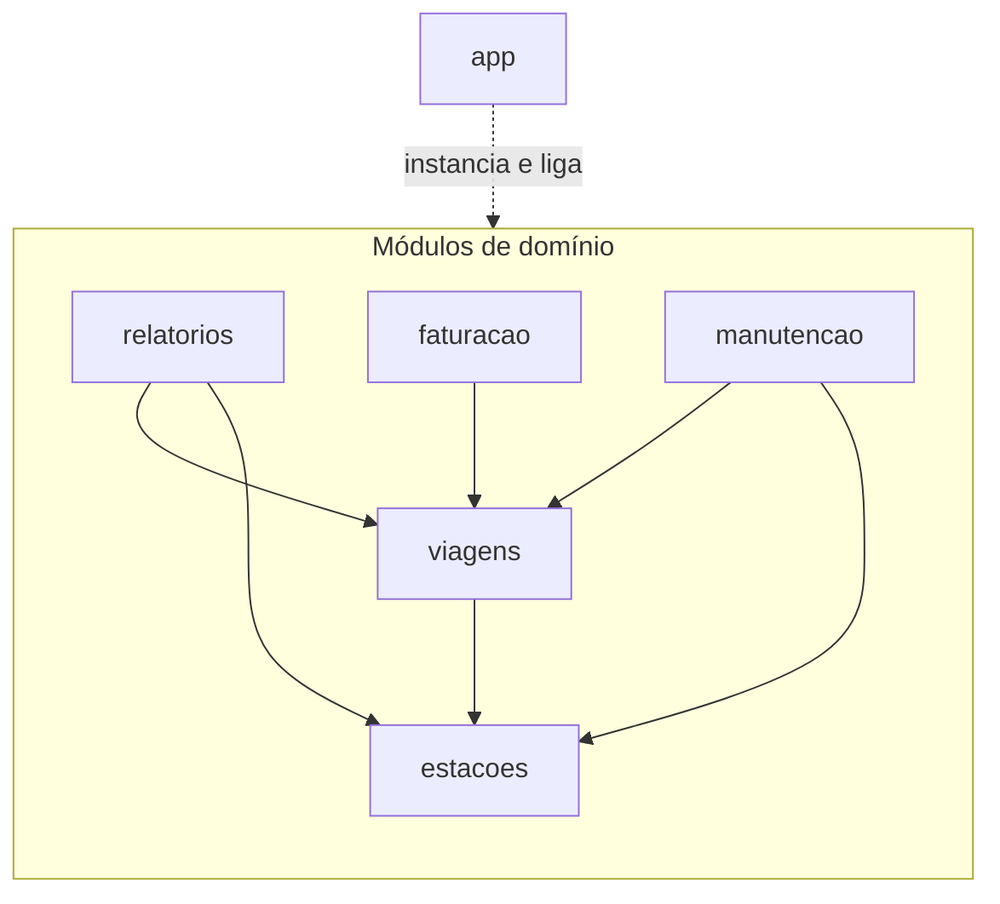
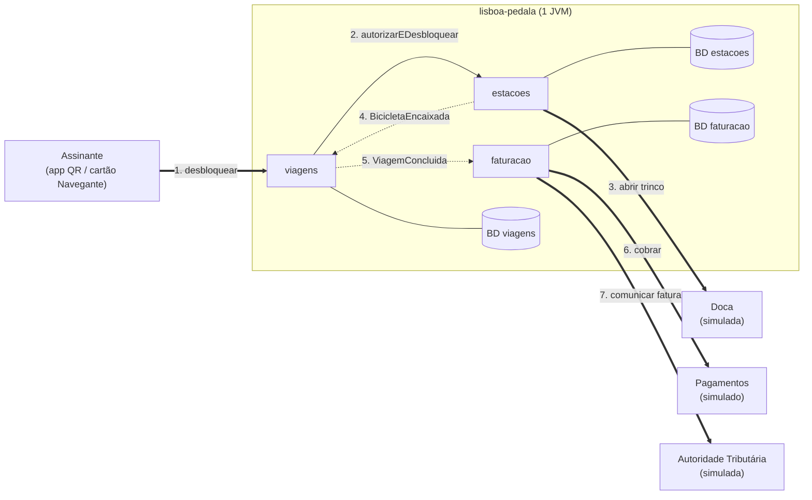
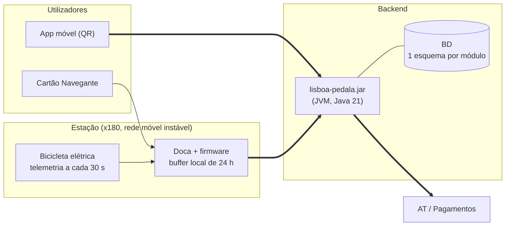

# 03 - Particionamento de Topo e Vistas Arquiteturais (Lisboa Pedala)

## 1. Particionamento de topo

### 1.1 Decisão

**Particionamento por domínio**, num **monólito modular** (ADR-001, ADR-002). Os pacotes de topo são os da coluna "Pacote Java" de `02-componentes.md`, mais `app`, que arranca o sistema e liga os módulos, sem lógica de negócio.

### 1.2 Trade-off

Nenhum corte é "o mais correto" (1.ª lei da arquitetura). O quadro compara-os pelos fatores que decidem este sistema.

| Fator (origem) | Corte técnico (camadas) | Corte por domínio (escolhido) |
| :--- | :--- | :--- |
| **Segurança e Conformidade**: fatura fiscal 10 anos vs percurso RGPD | A persistência é uma camada partilhada; a separação fatura/percurso depende de disciplina. | A fronteira é o pacote: `relatorios` nunca importa `faturacao`. Verificável com ArchUnit (regras R2 e R5). |
| **Disponibilidade**: a falha da AT ou da cobrança não pode bloquear a devolução | O fluxo desbloquear→devolver→cobrar atravessa 4 camadas, o que facilita cadeias de chamadas síncronas. | Cada capacidade é um módulo; entre módulos só há API ou eventos. `viagens` não depende de `faturacao` nem de `manutencao`. |
| **Elasticidade** | Nenhum dos cortes escala partes do sistema: a unidade de deployment é única. | Idem, mas as fronteiras ficam prontas para extrair `estacoes` ou a telemetria, se um dia for preciso. |
| **Viabilidade**: 3 elementos, orçamento fixo | Equipas por camada não se justificam com 3 pessoas. | Cada elemento é dono de módulos completos (Lei de Conway). |
| **Extensibilidade**: outras câmaras, dados abertos | O tarifário fica espalhado por controller e service. | O tarifário fica confinado a `faturacao`; os dados abertos são um novo consumidor de `relatorios`. |
| **Mudança típica**: alterar o bloco de 15 min do tarifário | Toca em 3-4 camadas. | Toca em 1 módulo. |
| **Mudança inversa**: trocar a interface de entrada (CLI↔REST) | Toca em 1 camada. | Toca nos 5 módulos. |

### 1.3 Custos aceites e mitigações

* **Conceitos duplicados entre módulos** (ADR-002). *Mitigação:* as APIs trocam apenas identificadores opacos (`BicicletaId`, `DocaId`, `ViagemId`) e records imutáveis; nunca entidades de persistência.
* **Código comum aparece em vários sítios.** Sem pacote `common` (ADR-002), os identificadores vivem no módulo dono e o tempo é `java.time.Instant` em UTC.
* **Consultas transversais.** `relatorios` não pode juntar tabelas de outros módulos; pede os dados às APIs. O relatório é mensal e em lote.

---

## 2. Vista de módulos
### 2.1 Decomposição

```
pt.ulisboa.pedala
 ├── viagens/        # GestaoViagens
 ├── estacoes/       # EstacoesDocas
 ├── manutencao/     # Manutencao
 ├── faturacao/      # TarifarioCobranca
 ├── relatorios/     # RelatoriosMunicipais
 └── app/            # arranque e ligação dos módulos sem lógica de negócio
```

| Componente | Módulo | Responsabilidade |
| :--- | :--- | :--- |
| `GestaoViagens` | `viagens` | Coordena o ciclo de vida da viagem e guarda o percurso. |
| `EstacoesDocas` | `estacoes` | Mantém o estado das estações e docas, comanda os trincos e autoriza desbloqueios. |
| `Manutencao` | `manutencao` | Converte avarias em ordens de reparação e bloqueia a bicicleta afetada. |
| `TarifarioCobranca` | `faturacao` | Aplica o tarifário, cobra, emite a fatura e comunica-a à AT. |
| `RelatoriosMunicipais` | `relatorios` | Agrega indicadores anonimizados para a Câmara e para os dados abertos. |

O `app` não é um componente lógico: só instancia os módulos e liga os subscritores aos publicadores. Pode usar todos; ninguém o usa.

### 2.2 Arquitetura Lógica



**Legenda:** `A → B` significa "A *pode usar* B". A seta tracejada é a ligação do arranque. Os módulos ordenam-se por estabilidade: `estacoes` em baixo, os consumidores em cima.

### 2.3 Matriz allowed-to-use

Lê-se "a linha pode usar a coluna". Tudo o que não está marcado com ✔ é **proibido**.

| *Allowed-to-use* | viagens | estacoes | manutencao | faturacao | relatorios |
| :--- | :---: | :---: | :---: | :---: | :---: |
| **viagens** | — | ✔  | ✘ | ✘ | ✘ |
| **estacoes** | ✘ | — | ✘ | ✘ | ✘ |
| **manutencao** | ✔  | ✔ | — | ✘ | ✘ |
| **faturacao** | ✔  | ✘ | ✘ | — | ✘ |
| **relatorios** | ✔  | ✔  | ✘ | ✘ | — |

As regras *allowed-to-use* correspondem às *fitness functions* (ArchUnit). Todas as regras podem ser encontradas, em detalhe, em `tests/architecture/`. Se uma falhar, o build falha.

---

## 3. Vista de componentes e conectores: fluxo desbloquear → devolver → cobrar

Fluxo da US-1. Aqui "componente" é uma entidade em execução.

### 3.1 Vista



**Legenda:** seta cheia = chamada síncrona em memória; seta tracejada  = evento em memória, assíncrono, após commit; seta grossa = ligação externa. Os números indicam a ordem. As setas mostram o **fluxo em execução**.

---

## 4. Vista de alocação

### 4.1 Arquitetura Física



**Legenda:** seta cheia = ligação interna; seta grossa = ligação de rede (móvel ou Internet). `AT / Pagamentos` são sistemas externos.

| Parte | Corre em | No esqueleto do trabalho |
| :--- | :--- | :--- |
| Módulos de domínio e `app` | Um único artefacto `lisboa-pedala.jar` | Igual. |
| Persistência | Alvo: BD relacional partilhada, um esquema por módulo, acedido só pelo dono | SQLite ou memória. |
| Doca e bicicleta | Estação, com buffer local de 24 h | Simuladas. |
| AT e pagamentos | Sistemas externos | Simulados. |

### 4.2 Atribuição de trabalho (CODEOWNERS)

Distribuição pensada para que cada user story tenha um dono principal.

| Elemento | Módulos | User story principal |
| :--- | :--- | :--- |
| `@Davidprpinheiro04` | `viagens`, `app` | US-1 |
| `@Brupos` | `estacoes`, `manutencao` | US-2 |
| `@matiasdavo` | `faturacao`, `relatorios` | US-4 |

Informação mais detalhada pode ser encontrada no ficheiro `CODEOWNERS`, na raíz do sistema. 
